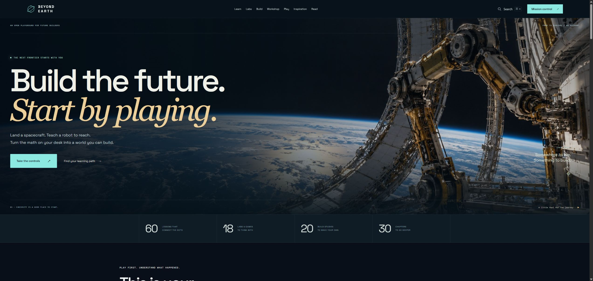

# Beyond Earth

**An interactive playground connecting the math on your desk to the things you want to build.**

[Explore the live website](https://ditchthescroll.com/beyond-earth/) · [Try the arcade](https://ditchthescroll.com/beyond-earth/#arcade) · [Learning paths](https://ditchthescroll.com/beyond-earth/#paths) · [Launch studio](https://ditchthescroll.com/beyond-earth/share.html)



## What you can do

- Fly a lunar descent, plan a two-burn orbital transfer, and position a robot arm across nine challenges.
- Tune a controller, compare beam designs, and investigate redundant systems; export measurements and design snapshots.
- Follow **60 lessons**, **10 learning paths**, **20 build studies**, and **18 labs and games**.
- Build a settlement and test how its services respond to outages and equipment failures.
- Explore a **30-chapter field guide**, a 264-page public PDF, and linked engineering sources.
- Watch eight finite, 90-second opening excerpts from industry talks, each connected to a lesson or project.
- Keep local progress, field notes, reviews, project records, and focus sessions without an account.

## Run locally

Requires Python 3 for the local server. No package installation, API key, database, or build step is needed.

```sh
git clone https://github.com/christrovato2000-stack/beyond-earth.git
cd beyond-earth
python -m http.server 8000 --bind 127.0.0.1 --directory site
```

Open <http://localhost:8000>. Serve over HTTP; opening HTML through `file://` does not load the modules and JSON correctly.

## Check the work

With Node.js 24 or later:

```sh
node scripts/check.cjs
```

The checks cover JavaScript syntax, flight and robot models, controller/beam/reliability calculations, learning-data references, foundations, progress persistence, multi-tab behavior, review/project backups, study timers, and sharing controls. The same command runs in GitHub Actions.

These tests validate the implemented teaching models and selected interactions. They do not certify hardware or guarantee external video availability. Equations and assumptions are documented beside the activities.

## How it is built

Plain HTML, CSS, browser JavaScript ES modules, SVG/canvas graphics, and JSON content. Hash routes select modules; route cleanup stops animation and removes listeners. Persistent learner records stay in browser storage. The site is hosted on Vercel at a path beneath an existing domain.

See [architecture and engineering decisions](docs/ARCHITECTURE.md), [verification notes](docs/VERIFICATION.md), and [project history](WORKLOG.md).

## Repository map

| Path | Contents |
| --- | --- |
| `site/` | Complete deployable public website, including assets and downloads |
| `site/data/` | Lessons, paths, chapters, sources, and reel metadata |
| `site/assets/social/v4/` | Two promotional graphics, gameplay film, poster, and social preview |
| `site/downloads/` | Sanitized public PDF and editable manuscript |
| `tests/` | Model, data, storage, and interface regression checks |
| `docs/launch/` | Three posts, media descriptions, research, and generation prompts |
| `WORKLOG.md` | Dated records of changes, evidence, learning, and next steps |

## Development and attribution

This is a project directed and iterated by [christrovato2000-stack](https://github.com/christrovato2000-stack), developed with substantial OpenAI Codex assistance for implementation, research, writing, visuals, and verification. The repository records the resulting work transparently; it is not a claim that every line was written manually.

Engineering sources are linked in the lessons and field guide. The cinematic artwork and two launch illustrations were AI-generated; the simulation graphics are code-rendered and the launch film captures actual site interactions. Third-party talks are linked or embedded from their publishers, not copied into this repository. See [sources and media](docs/ATTRIBUTION.md).

## Continue the project

Use [the contribution and daily-work guide](CONTRIBUTING.md) to make a small change, test it, document what you learned, and commit it. The Git history begins with this October 30, 2026 import; earlier work is described in the log rather than represented as backdated commits.
